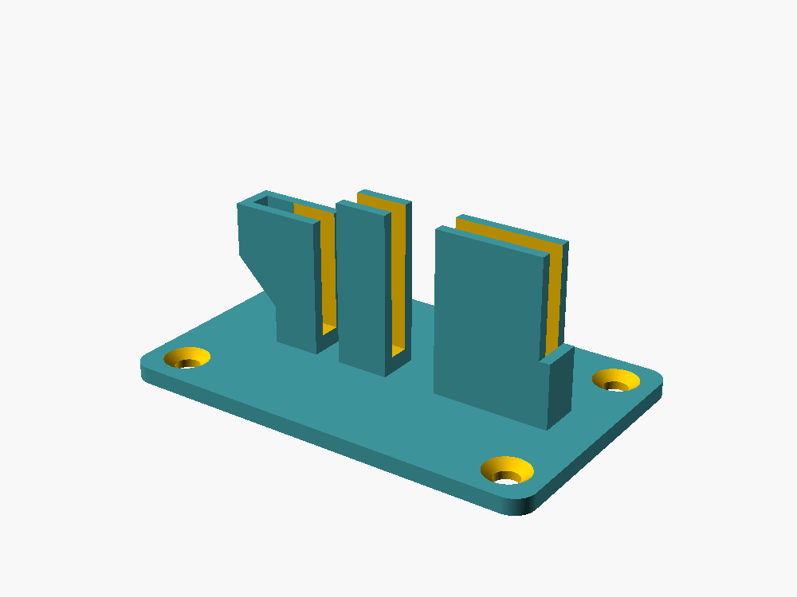

# DWM1002 Desktop Stand

Parametric OpenSCAD source for holding the DWM1002 PDoA node vertically on a
small platform.

The preview shows only the printable stand, without the reference PCB.

The current model uses:

- an `80 x 50 x 3 mm` rounded base;
- four countersunk M4 mounting holes;
- three independent saddles measured from the nominal `60 mm` PCB left edge: a
  `25 mm` high saddle at `6-15 mm`, plus `30 mm` high saddles at `20-30 mm` and
  `40-60 mm`;
- `2 mm` front and rear saddle walls;
- a perpendicular `12 mm` high right-hand stop joined to the third saddle;
- a raised left-hand stop from `15 mm` to `25 mm`, leaving the USB-C area below
  `13 mm` unobstructed, with two printable 45-degree support gussets;
- a `4 mm` internal envelope around the lower PCB area;
- an unobstructed board area above `45 mm`;
- an open left side for USB cable access.

Open `dwm1002-stand.scad` in OpenSCAD and press `F5` for preview. The translucent
green board and red clearance marker are preview-only and are not exported.
Press `F6`, then export the stand as STL.

Measure the assembled node before printing. Adjust `pcb_envelope`,
`saddle_intervals`, and the mounting-hole parameters at the top of the source
if connectors or components interfere with a saddle. Additional intervals can
be appended to `saddle_intervals` without changing the model geometry code.
